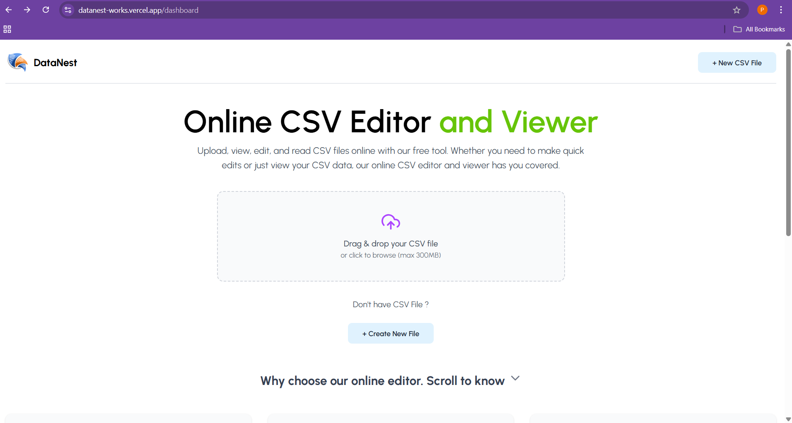
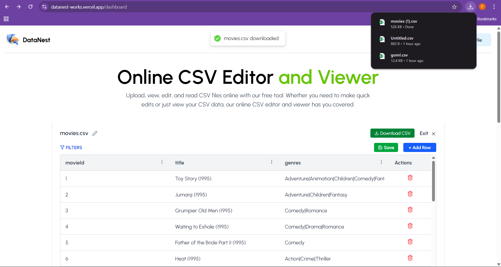
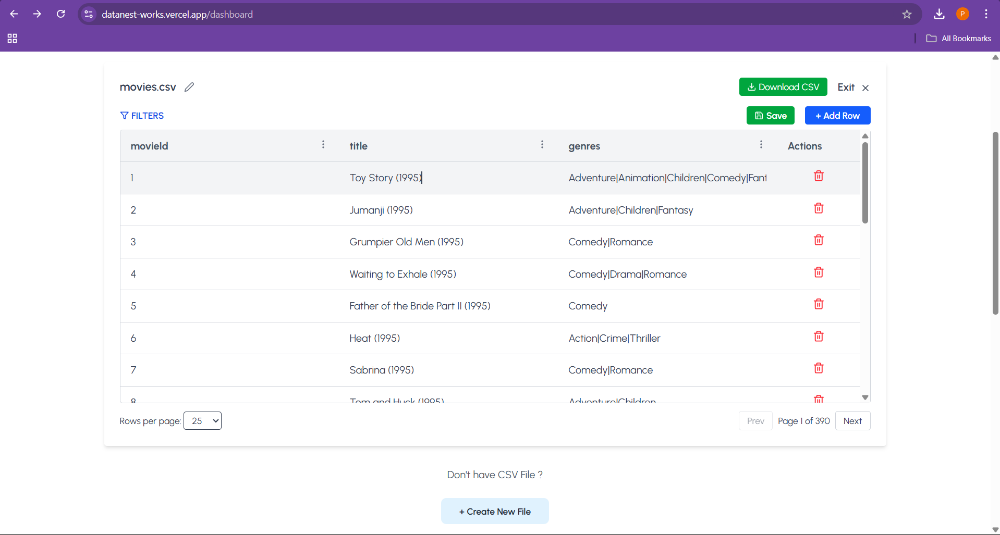
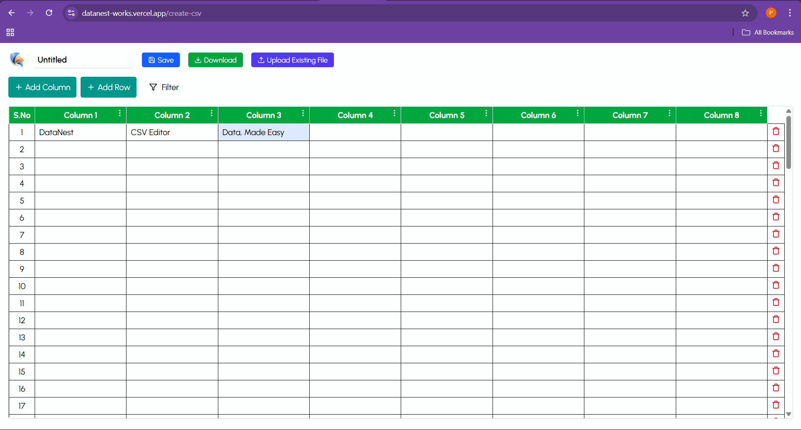

# DataNest – Data, Made Easy

<p align="left">
  
</p>

**Effortlessly manage your CSV files online with DataNest.**

Upload, edit, and export CSV files directly in your browser. No sign-up required.

---

## 🚀 Features

- ✅ Drag & Drop CSV Upload
- ✅ In-Browser Table Editing
- ✅ Export Edited Files
- ✅ Real-Time Data Updates
- ✅ Clean, Responsive User Interface
- ✅ No Login or Signup Required

---

## 🌐 Live Demo

[Visit DataNest](https://datanest-works.vercel.app)

---

## 🛠️ Tech Stack

| Technology | Purpose |
|---|---|
| HTML5 | Structure |
| CSS3 | Styling |
| JavaScript | Application logic |
| React.js | Frontend development |
| Vite | Development and build tool |
| EmailJS | Email integration |
| Vercel | Deployment |

---

## 📦 Getting Started

### Prerequisites

- Node.js
- npm
- Git

### 1. Clone the repository

```bash
git clone YOUR_GITHUB_REPOSITORY_URL
```

### 2. Navigate to the frontend directory

```bash
cd DataNest-Online-CSV-Editor/frontend
```

### 3. Install dependencies

```bash
npm install
```

### 4. Start the development server

```bash
npm run dev
```

### 5. Open in your browser

```text
http://localhost:5173/
```

---

## 📸 Screenshots

### Upload CSV and Export File

| Upload CSV | Export File |
|---|---|
|  |  |

### View and Edit CSV

| View & Edit File | New File Editor |
|---|---|
|  |  |

---

## 🚧 Future Enhancements

- ✉️ Email Feature – Send CSV files directly via email.
- 🌙 Dark Mode – Improve usability in low-light environments.
- 🤝 Real-Time Collaboration – Allow multiple users to edit the same file.
- 📂 Large CSV Support – Improve performance when handling large datasets.
- 📤 Multiple Export Formats – Support CSV, Excel, JSON, and more.

---

## 👨‍💻 Contributions

This repository is based on the original DataNest project developed by Praveen Kumar V.

Further modifications and contributions will be documented here as development progresses.

---

## 📄 License

Refer to the original repository for licensing and reuse permissions.
